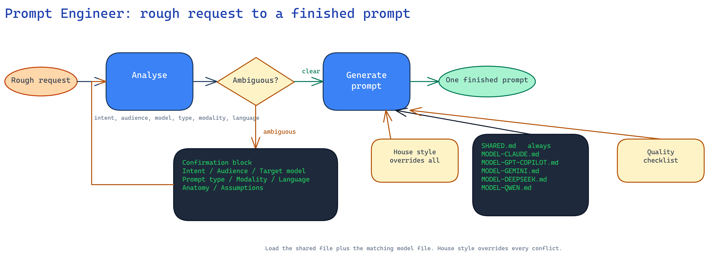

# Skills

A collection of agent skills. Each skill turns a rough request into a finished result. Maintained by Marcus Ford.

## Skills

### User-invoked

These skills run only when you type the name.

| Skill | Description |
| --- | --- |
| [skill-improvement](productivity/skill-improvement/) | Reviews an existing agent skill and takes it to a fixed bar: contract, gate, evals, audit. Run it deliberately, not mid-task. |

### Model-invoked

These skills fire on their own when the task fits. Type the name to run one directly.

| Skill | Description |
| --- | --- |
| [prompt-engineer](productivity/prompt-engineer/) | Turns a rough request into one finished prompt for a target AI model. Also critiques, tests, and improves prompts. |
| [podcast-script](productivity/podcast-script/) | Turns a report or raw notes into a podcast script and the plain text for kokoro-tone, kokoro-fastapi, kokoro-raw, or ElevenLabs. Covers solo, two-host, and panel shows. |

## Install

Setup runs in five places.

1. [OpenCode](#opencode), a native skill, no setup beyond the files.
2. [Microsoft 365 Copilot](#microsoft-365-copilot), regular Copilot, not Copilot Studio.
3. [ChatGPT](#chatgpt).
4. [Gemini](#gemini-gems).
5. [Claude](#claude).

### Files

- `productivity/prompt-engineer/SKILL.md`, the agent instructions, frameworks, and style rules.
- `productivity/prompt-engineer/MODEL-CLAUDE.md`, `productivity/prompt-engineer/MODEL-GPT-COPILOT.md`, `productivity/prompt-engineer/MODEL-GEMINI.md`, `productivity/prompt-engineer/MODEL-DEEPSEEK.md`, and `productivity/prompt-engineer/MODEL-QWEN.md`, the model knowledge files.
- `productivity/prompt-engineer/agents/openai.yaml`, the OpenAI and Codex interface manifest.

Install needs the `prompt-engineer` folder alone. Keep the files together inside the folder. The `docs` folder holds the flow diagram for reference and forms no part of the install.

### Agent instructions

The agent instructions live in `productivity/prompt-engineer/SKILL.md`. Copy the body of that file, from the `# Prompt Engineer` heading down, into the platform instructions field. The front matter at the top is for OpenCode only and is not part of the pasted text.

When the platform supports knowledge files, upload the five model knowledge files from the skill folder. When the platform does not, paste the SKILL.md body and the matching model file into the knowledge or context area, or prepend both to a request.

### OpenCode

OpenCode loads skills from disk. No account or app is needed.

1. Copy the `prompt-engineer` folder into a skills directory.
   - Project scope: `<your-project>/.opencode/skills/prompt-engineer/`
   - Global scope: `~/.config/opencode/skills/prompt-engineer/`
2. Keep the folder layout intact, so `SKILL.md` and the knowledge files stay together.
3. Start a new OpenCode session so the session discovers the skill.
4. Ask in plain language, for example: write me a prompt for a non-technical executive summary, targeting ChatGPT.

Verify: the session lists `prompt-engineer` among available skills.

### Microsoft 365 Copilot

Regular Microsoft 365 Copilot Chat, not Copilot Studio.

1. Sign in at <https://m365.cloud.microsoft/chat>, or open Copilot in Teams.
2. Choose Create an agent, or open the Agents area and pick New agent.
3. Name the agent Prompt Engineer and give the agent a short description.
4. Paste the SKILL.md body into the Instructions box.
5. Under Knowledge, add the five model knowledge files. Upload the files from OneDrive or SharePoint, since Copilot grounds agents on Microsoft 365 content.
6. Save, then open the agent from Copilot Chat and describe the prompt you want.

If the tenant does not show the agent builder, use the no-setup path. Start a Copilot chat, paste the SKILL.md body, then add the request on the next line. Save the instructions for reuse.

### ChatGPT

Two options. Custom GPTs support knowledge files. Custom instructions apply to every chat.

#### Custom GPT, knowledge files supported

1. Open ChatGPT and go to Explore GPTs, then Create.
2. Switch to the Configure tab.
3. Set the name to Prompt Engineer and add a short description.
4. Paste the SKILL.md body into the Instructions box.
5. Under Knowledge, upload the five model knowledge files.
6. Save, then set the access level for the GPT. Open the GPT and describe the prompt you want.

#### Custom instructions, no files

1. Open Settings, then Personalization, then Custom instructions.
2. Paste the SKILL.md body into the field about how ChatGPT should respond.
3. Save. Start a new chat and describe the prompt you want.

Note: custom instructions have a length limit. If the body does not fit, paste the framework section and trim the model list.

### Gemini (Gems)

Gems are the saved, reusable assistants in Gemini.

1. Open <https://gemini.google.com> and choose Gems in the sidebar.
2. Choose New Gem.
3. Name the Gem Prompt Engineer and add a short description.
4. Paste the SKILL.md body into the instructions field.
5. Attach the five model knowledge files if the plan allows uploads.
6. Save, then open the Gem and describe the prompt you want.

Note: file attachments in Gems need a paid Google plan. Without uploads, paste the SKILL.md body into the first message of a chat and keep the Gem open.

### Claude

Claude Projects hold instructions plus a project knowledge base.

1. Open <https://claude.ai> and go to Projects.
2. Choose New Project and name the project Prompt Engineer.
3. Open the project instructions and paste the SKILL.md body.
4. Add the five model knowledge files to the project knowledge.
5. Start a chat inside the project and describe the prompt you want.

Alternative without a Project: open Settings, then Profile, and paste the SKILL.md body into the custom instructions field. This applies to every chat and carries no knowledge files.

### Check the setup

Send this request on any platform:

> Write me a prompt for turning a meeting transcript into five action items with owners.

Check the reply against three things:

- The reply returns one finished prompt, with no preamble.
- The reply follows the style rules in SKILL.md: no em dashes, no banned words.
- The reply names the target model, or defaults to Claude when you do not name one.

### Tips

- Name the target model every time. Each model family has its own prompt mechanics.
- Say what the audience cares about. Non-technical executives beats general audience.
- Ask for a system prompt explicitly when you configure a bot.
- For images and documents, say what is attached and what to extract.
- Refine in place. Follow-ups adjust the same prompt rather than starting over.

## prompt-engineer



Turns a rough request into one finished, ready-to-use prompt for a chosen AI model. Ask for a prompt, and get a single usable result rather than a draft. Give an existing prompt, and the skill critiques, tests, or improves the prompt against best practice.

Runs as an OpenCode skill, and as an agent or Gem on Microsoft 365 Copilot, ChatGPT, Gemini, and Claude.

### Supported models

| Target | Knowledge file |
| --- | --- |
| Claude, the default | `productivity/prompt-engineer/MODEL-CLAUDE.md` |
| ChatGPT, Microsoft Copilot | `productivity/prompt-engineer/MODEL-GPT-COPILOT.md` |
| Gemini | `productivity/prompt-engineer/MODEL-GEMINI.md` |
| DeepSeek | `productivity/prompt-engineer/MODEL-DEEPSEEK.md` |
| Qwen | `productivity/prompt-engineer/MODEL-QWEN.md` |

`productivity/prompt-engineer/SKILL.md` always loads. The file carries the frameworks and the style rules. The model files add the mechanics each family needs.

## podcast-script

Turns a report, document, or raw notes into a podcast script and the plain text the chosen model reads. It covers solo narration, two-host shows, and panels of three or more hosts. The script is model-neutral: it carries voice, emotion, rate, pause, and pronunciation markers, and a model file compiles them into the target's text dialect. Targets kokoro-tone, kokoro-fastapi, kokoro-raw, and ElevenLabs.

The model file says what the text carries. The skill writes to the chosen model and records any marker the text cannot carry. Variety comes from rate, pause, sentence length, and word choice.

The skill stops at the text. It builds no payload and calls no service; research, rendering, mastering, and publishing belong elsewhere.

Runs as an OpenCode skill, and as an agent or Gem on Microsoft 365 Copilot, ChatGPT, Gemini, and Claude.

### Files

- `productivity/podcast-script/SKILL.md`, the workflow and compiled text.
- `MODELS.md`, the model registry and choosing rules.
- `MODEL-KOKORO-TONE.md`, inline tags for every marker.
- `MODEL-KOKORO-FASTAPI.md`, plain text with punctuation for pauses.
- `MODEL-KOKORO-RAW.md`, plain text with blank lines for pauses.
- `MODEL-ELEVENLABS.md`, inline emotion cues with punctuation for pauses.
- `PROFILE.md`, the typed host profile and gate.
- `PERFORMANCE.md`, pacing, emotion, emphasis, and performance moves.
- `TICKS.md`, the tick library, density rules, and banlist.
- `HANDOFF.md`, the compile procedure, the text file, and the notes contract.
- `SCRIPT-CRAFT.md`, structure, prose, punctuation, and attribution.
- `VOICE.md`, casting, rate, and pause.
- `MULTIHOST.md`, two-host relationship and handoffs.
- `PANEL.md`, three or more hosts.
- `VERIFY.md`, the release gate.
- `examples/`, example snippets for a host profile, a beat map, a solo script, a two-host script, and a panel script.
- `agents/openai.yaml`, the OpenAI and Codex interface manifest.

### Install

OpenCode:

1. Copy the `podcast-script` folder into a skills directory.
   - Project scope: `<your-project>/.opencode/skills/podcast-script/`
   - Global scope: `~/.config/opencode/skills/podcast-script/`
2. Keep the folder layout intact, so `SKILL.md` and the reference files stay together.
3. Start a new OpenCode session so the session discovers the skill.
4. Ask in plain language, for example: turn this report into a two-host podcast script for ElevenLabs.

Other platforms:

- Microsoft 365 Copilot: paste the `SKILL.md` body into the agent instructions and add the reference files as knowledge.
- ChatGPT: paste the `SKILL.md` body into a Custom GPT and upload the reference files.
- Gemini: paste the `SKILL.md` body into a Gem and attach the reference files.
- Claude: paste the `SKILL.md` body into a Project and add the reference files to project knowledge.

### Verify

Send a short report or a page of raw notes and ask for a solo podcast script. Check three things:

- The reply writes `<source-stem>-podcast-script.md`, `<source-stem>-tts-<model>.txt`, and `<source-stem>-script-notes.md` next to the source.
- The script starts with a cold open, not a title, and ends with a closing line, not `END`.
- The notes name the model. The compiled text carries the spoken words and resolves every marker, and holds no payload.

## skill-improvement

Reviews an existing skill and takes it to a fixed bar. Five phases: survey, gauntlet, gate, evals, prove. Three reviewers run in rounds — Runs, Reads, Audit — and the loop exits at zero blockers and zero majors.

The output is a review at `reviews/<skill>.md` and, when you ask for it, a fixed skill with a numbered gate and an eval suite outside its folder.

User-invoked: type `/skill-improvement` or name it. It stays out of the model's list, because a review is a deliberate, expensive act.

### Files

- `SKILL.md`, the five phases, the severity model, and the eight laws.
- `SURVEY.md`, inventory, contract, and the fact table.
- `GAUNTLET.md`, the three reviewer briefs and the round loop.
- `CRAFT.md`, the five writing levers as checks.
- `GATE.md`, designing numbered checks and a step map.
- `EVALS.md`, scenarios, fixtures, runs, and regression.
- `VARIANTS.md`, neutral core, variant files, and capability tables.
- `AUDIT.md`, sixteen mechanical checks with commands.
- `REPORT.md`, the review template.
- `examples/`, a filled report, a gate, and an eval README.
- `agents/openai.yaml`, the OpenAI and Codex interface manifest.

### Install

OpenCode:

1. Copy the `skill-improvement` folder into a skills directory.
   - Project scope: `<your-project>/.opencode/skills/skill-improvement/`
   - Global scope: `~/.config/opencode/skills/skill-improvement/`
2. Keep the folder layout intact, so `SKILL.md` and the reference files stay together.
3. Start a new OpenCode session, then load it by name: `@skill-improvement`.

The frontmatter sets `disable-model-invocation: true`, so OpenCode keeps it out of the model's list and loads it only when you name it.

Other platforms:

- Microsoft 365 Copilot: paste the `SKILL.md` body into the agent instructions and add the reference files as knowledge.
- ChatGPT: paste the `SKILL.md` body into a Custom GPT and upload the reference files.
- Gemini: paste the `SKILL.md` body into a Gem and attach the reference files.
- Claude: paste the `SKILL.md` body into a Project and add the reference files to project knowledge.

### Verify

Point it at a skill and ask for an audit. Check three things:

- It writes `reviews/<skill>.md` with a verdict line and the severity counts.
- Every finding carries a file, a line, a severity, and a fix.
- The audited skill is unchanged.

## Evals

Each skill's evals live beside it under `evals/`, mirroring the skill path. They sit outside the skill folder on purpose: the skill never reads them, and only the tester does.

- `evals/productivity/podcast-script/`, three scenarios and their fixtures.
- `evals/productivity/skill-improvement/`, three scenarios, a broken fixture with eleven planted defects, and a clean fixture.

## Repository layout

```text
productivity/
  prompt-engineer/
    SKILL.md                        agent instructions, frameworks, style rules
    MODEL-CLAUDE.md                 Claude mechanics
    MODEL-GPT-COPILOT.md            ChatGPT and Copilot mechanics
    MODEL-GEMINI.md                 Gemini mechanics
    MODEL-DEEPSEEK.md               DeepSeek mechanics
    MODEL-QWEN.md                   Qwen mechanics
    agents/openai.yaml              OpenAI and Codex interface manifest
  skill-improvement/
    SKILL.md                        five phases, severity, the eight laws
    SURVEY.md                       inventory, contract, fact table
    GAUNTLET.md                     three reviewer briefs, rounds
    CRAFT.md                        five writing levers as checks
    GATE.md                         numbered checks and step map
    EVALS.md                        scenarios, fixtures, runs
    VARIANTS.md                     core, variant files, capability tables
    AUDIT.md                        sixteen mechanical checks
    REPORT.md                       review template
    examples/                       report, gate, eval README
    agents/openai.yaml              OpenAI and Codex interface manifest
  podcast-script/
    SKILL.md                        workflow and compiled text
    MODELS.md                       model registry and choosing rules
    MODEL-KOKORO-TONE.md            self-hosted gateway, the default
    MODEL-KOKORO-FASTAPI.md         OpenAI-compatible Kokoro server
    MODEL-KOKORO-RAW.md             kokoro Python package, no server
    MODEL-ELEVENLABS.md             ElevenLabs through OpenRouter
    PROFILE.md                      typed host profile and gate
    PERFORMANCE.md                  pacing, emotion, emphasis, moves
    TICKS.md                        tick library, density, banlist
    HANDOFF.md                      compile rules, text file, notes contract
    SCRIPT-CRAFT.md                 structure, prose, punctuation, attribution
    VOICE.md                        casting, rate, pause
    MULTIHOST.md                    two-host relationship and handoffs
    PANEL.md                        three or more hosts
    VERIFY.md                       release gate
    examples/                       host profile, beat map, solo, two-host, panel
    agents/openai.yaml              OpenAI and Codex interface manifest

evals/
  productivity/
    podcast-script/                 three scenarios and their fixtures
    skill-improvement/              three scenarios, two fixtures

reviews/
  skill-improvement.md              the skill's review of itself

docs/
  prompt-engineer-flow.excalidraw   editable diagram source
  prompt-engineer-flow.png          rendered diagram
```

## License

MIT. See [LICENSE](LICENSE).
